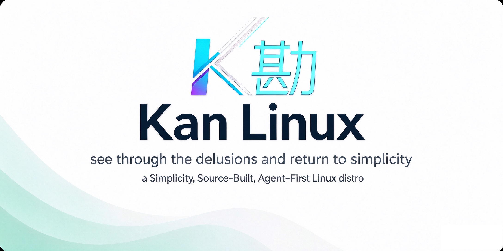

  <picture>
    <source
      media="(prefers-color-scheme: dark)"
      srcset="assets/kanlinux-banner.png"
    />
    <source
      media="(prefers-color-scheme: light)"
      srcset="assets/kanlinux-banner.png"
    />
    
  </picture>

<!--<h1 align="center">Kan-Linux</h1>-->

  <strong>English</strong> |
  <a href="/docs/README.zh-CN.md">中文</a>

 

## Description

**Kan-Linux**(or KanLinux) is a **Concise**, **Security** and **Agent‑First** Linux distribution\. The name **Kan(勘)** derives from *Instructions for Practical Living* by [Wang Yangming](https://en.wikipedia.org/wiki/Wang_Yangming), representing the philosophy of breaking through technical obscurations and returning to the system’s original simplicity\. The name **Kan(勘)** also stands for "*see through the delusions and return to simplicity*".

The main goal of Kan-Linux is to build a concise, secure and Agent-first Linux distro at the edge --- locally and in the cloud.

#### Design Principles
- Simplicity — Eliminate overly complex wrapper layers and overengineering, following the **core philosophy** of [ggml/llama.cpp](https://github.com/ggml-org/llama.cpp). **Not dependent on any existing Linux distribution**.
- **Do not adopt GNOME or KDE desktop stacks** even though GTK and Qt are really good. Instead, it builds a lean, minimal desktop environment on its own, with pluggable applications and no mandatory global metadata, introspection, or highly complex hidden runtime contracts.
- Monorepo — Drawing lessons from **many** existing Linux distributions and the **highly sophisticated [Yocto](https://www.yoctoproject.org/)** Project, the project uses an AOSP-style single-repository architecture. All source code lives in one repository to simplify development, building and maintenance.
- Secure — The goal is not to build an unbreakable Linux distro, but to minimize TCB/attack surface and maximize SBOM/supply-chain security.
  - Single-user desktop computing — Optimized for single-user desktop workflows to minimize attack surface.
  - Source-Built — The entire OS and all components (excluding prebuilt components such as Go, Rust, Firefox, Vulkan SDK, MiMo-Code, and user-installed components) are built from source, maximize SBOM and supply-chain security.
  - Do not adopt SELinux due to minimize TCB.
  - AI-native security audit pipeline — Kan-Linux embeds LLM-based source-level security audit (GLM-5.3 and other top-tier LLM models) as a mandatory gate before compilation. Security is shifted from "binary post-scanning" to source pre-admission auditing.
- llama.cpp-First — Built-in native llama.cpp edge inference engine for **local AI deployment**.
- Agent-First — **No package manager**. AI agents autonomously compile, deploy, install components, run system checks and resolve issues.

#### Differences and Connections with Omarchy
- Omarchy targets end users, delivering an out-of-the-box complete desktop system, with **visual polish as one of its core goals**.
- **Kan‑Linux targets programmers, AI researchers and Linux distribution builders**, providing a neutral Wayland underlying graphics platform. Its core goals are **controllability**, **auditability**(no black-box within the OS), **modularity and reproducible builds**, and **visual polish is not a project objective**.
- Kan‑Linux draws inspiration from [Omarchy’s desktop shell](https://github.com/kan-linux/omarchy), and integrates it as our optional early default desktop shell. We port this tasteful shell as an upper-layer UI example to show the capabilities of the Kan-Linux platform. Even if we remove or disable the Omarchy desktop shell in the future due to unexpected reasons, the whole system and graphics infrastructure can still run fully and independently.
- Omarchy is based on the upstream Arch Linux distribution, while Kan-Linux is built completely from scratch and **does not rely on any upstream Linux distribution**.

#### Screenshots and LiveISO

Please refer to https://github.com/kan-linux/kan/releases/tag/v0.3.1

## Contributing

Pls refer to [How to contribute to Kan‐Linux](https://github.com/kan-linux/kan/wiki/How-to-contribute-to-Kan%E2%80%90Linux)

## Wiki
https://github.com/kan-linux/kan/wiki

## Limitations
- Currently focus on x86-64 laptops, PCs and hardware
- Tested and verified on limited x86-64 laptops and PCs
- Built-in support for AMD and Intel GPUs. Nvidia GPU support requires assistance from the built-in Agent or a domain specialist
- The installer supports only single-OS installation to a specified partition or a standalone disk among multiple disks; LUKS encryption is not yet supported

## Acknowledgements
- Inspired by Omarchy(**"Convention over Configuration"**) and [Omarchy's desktop shell](https://github.com/omacom/omarchy)
- Inspired by [llama.cpp](https://github.com/ggml-org/llama.cpp)
- Thanks to the entire Linux community(various tech orgs, such as Redhat(RHEL/Fedora/QEMU), SPI(Debian), Linux Foundation, Linaro, Canonical(Ubuntu), System76(Pop!_OS), UnionTech(Deepin/UOS)... and tech stacks)
- Special thanks to the AI assistant for extensive technical discussions, architectural advice, and writing assistance throughout the development of Kan-Linux

## Language Policy and AI Policy

- To facilitate clear and effective communication, all discussions, comments, documentation, and PRs in this project **should be** conducted in English, this ensures that all contributors can participate and collaborate effectively.
- English and Chinese are **both fine** for issues and discussions.
- Discussions, issues and PRs should include **human-written content**. **AI-assisted polish is accepted and welcomed**(many of us are non-native English speakers). What matters is not who typed the content but whether a human understands it.
- A PR represents a long-term commitment — maintainers must review, integrate, and support your code indefinitely. What matters is not who wrote the code but whether a human understands it: **either fully, or at the 70–90% level, and is able to explain major change to reviewers, even with AI assistance**.
- Fully AI-generated content and fully automated PRs are not permitted. We value human connection and communication over fully AI-driven interaction.

## Trademarks
This project may include trademarks or logos belonging to third parties. Use of any third-party trademarks is governed by their respective policies.

