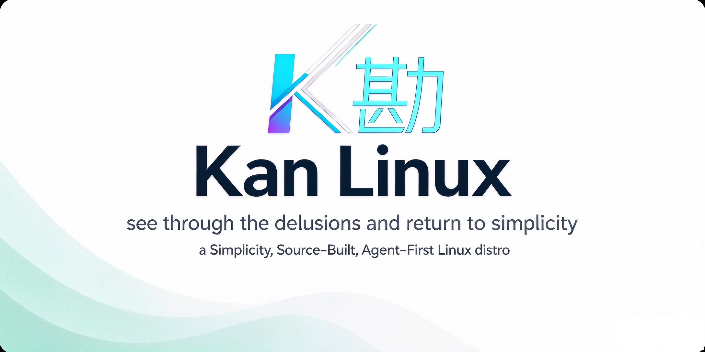
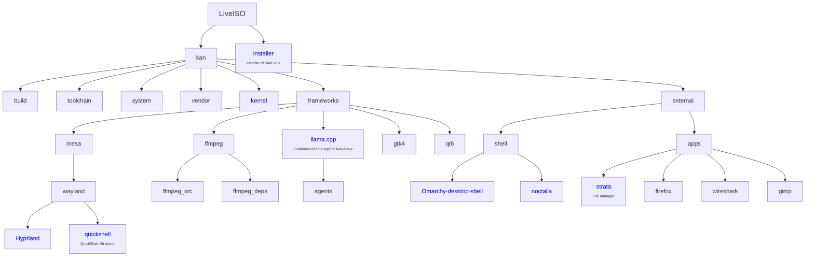

<p align="center">
  <picture>
    <source
      media="(prefers-color-scheme: dark)"
      srcset="assets/kanlinux-banner.png"
    />
    <source
      media="(prefers-color-scheme: light)"
      srcset="assets/kanlinux-banner.png"
    />
    
  </picture>
</p>

<!--<h1 align="center">Kan-Linux</h1>-->

<p align="center">
  <strong>English</strong> |
  <a href="/docs/README.zh-CN.md">中文</a>
</p>

<br>

## Description

**Kan-Linux**(or KanLinux) is a **Concise**, **Source‑Built**, **Security** and **Agent‑First** Linux distribution\. The name **Kan(勘)** derives from *Instructions for Practical Living* by [Wang Yangming](https://en.wikipedia.org/wiki/Wang_Yangming), representing the philosophy of breaking through technical obscurations and returning to the system’s original simplicity\. The name **Kan(勘)** also stands for "*see through the delusions and return to simplicity*".

The main goal of Kan-Linux is to build a simple, source-built, secure and Agent-first Linux distro at the edge --- locally and in the cloud.

#### Design Principles
- Simplicity — Eliminate overly complex wrapper layers and overengineering, following the **core philosophy** of [ggml/llama.cpp](https://github.com/ggml-org/llama.cpp). **Not dependent on any existing Linux distribution**.
- Monorepo — Drawing lessons from **many** existing Linux distributions and the **highly sophisticated [Yocto](https://www.yoctoproject.org/)** Project, the project uses an AOSP-style single-repository architecture. All source code is stored and hosted in one single code repository to simplify development, build and maintenance work.
- Source-Built — The entire OS and all components (excluding prebuilt components such as Go, Rust, Firefox, Vulkan SDK, MiMo-Code, and user-installed components) are built from source.
- llama.cpp-First — Built-in native llama.cpp edge inference engine for **local AI deployment**.
- Agent-First — **No package manager**. AI agents autonomously compile, deploy, install components, run system checks and resolve issues.
- AI-native security audit pipeline — Kan-Linux embeds LLM-based source-level security audit (GLM-5.3 and others) as a mandatory gate before compilation. Security is shifted from "binary post-scanning" to source pre-admission auditing.


#### Screenshots and LiveISO

Please refer to https://github.com/kan-linux/kan/releases/tag/v0.2.9

<!--
## Contributing

- Contributors can open PRs
- Collaborators will be invited based on contributions
- Maintainers can push to branches in the `kan` repo and merge PRs into the `master` branch
- Any help with managing issues, PRs and projects is very appreciated!
- Read the [CONTRIBUTING.md](CONTRIBUTING.md) for more information
-->

#### How to use patch mechanism in your installed Kan-Linux

Go, Rust, Vulkan SDK, MiMo-Code and firmware can be installed **on demand** via your preferred AI agent / LLM skills

Instruct your preferred agent:

```
download https://kan-linux.org/patches/install-prebuilts.sh to /opt/skills/install-devtoolchain.sh

then execute sudo /opt/skills/install-prebuilts.sh to install Go / Rust / Vulkan SDK / MiMo-Code.
```

## Open-Source

We have benefited from the open-source community, and we wish to contribute back to it.




## Contributing
We welcome feedback in [discussions](https://github.com/kan-linux/kan/discussions) for any issues you encounter while testing the LiveISO or after installing Kan-Linux on physical x86-64 laptops/PCs/hardware.


## Roadmap
- [x] Stage 1: Complete [PoC validation](https://github.com/kan-linux/kan/releases/tag/v0.2.6) of Kan-Linux via QEMU virtual machine
- [x] Stage 2.1: Integrate a preliminary, feature-limited, [customized Omarchy desktop shell](https://github.com/kan-linux/omarchy/tree/kan) and login greeter for QEMU virtual machine environments
- [x] Stage 2.2: Enable and validate Kan-Linux installer via QEMU virtual machine
- [x] Stage 2.3: Refine and stabilize via QEMU virtual machine
- [ ] Stage 2.4: Enable and validate the Kan-Linux boot and runtime support for physical x86_64 desktop PCs / laptops
- [ ] Milestone: Kan-Linux achieves full self-hosting. All subsequent development, building and iteration of Kan-Linux will happen **inside Kan-Linux itself**.
- [ ] Stage 2.5: Integrate desktop-native AI Agent in Kan-Linux on physical x86_64 hardware
- [ ] Stage 2.6: Refine and stabilize for physical x86_64 desktops / laptops
- [ ] Stage 3: Refine and stabilized Kan-Linux on physical x86_64 hardware

## Limitations
- Currently focused on x86-64 laptops, PCs and hardware
- Built-in support for AMD and Intel GPUs. Nvidia GPU support requires assistance from the built-in Agent or a domain specialist.


## Differences and Connections with Omarchy
- Omarchy targets end users, delivering an out-of-the-box complete desktop system, with **visual polish as one of its core goals**.
- **Kan‑Linux targets programmers, AI researchers and Linux distribution builders**, providing a neutral Wayland underlying graphics platform. Its core goals are **controllability**, **auditability**(no black-box within the OS), **modularity and reproducible builds**, and **visual polish is not a project objective**.
- Kan‑Linux draws inspiration from [Omarchy’s desktop shell](https://github.com/kan-linux/omarchy), and integrates it as our optional early default desktop shell. We port this tasteful shell as an upper-layer UI example to show the capabilities of the Kan-Linux platform. Even if we remove or disable the Omarchy desktop shell in the future due to unexpected reasons, the whole system and graphics infrastructure can still run fully and independently.
- Omarchy is based on the upstream Arch Linux distribution, while Kan-Linux is built completely from scratch and **does not rely on any upstream Linux distribution**.

## Acknowledgements
- Inspired by Omarchy(**"Convention over Configuration"**) and [Omarchy's desktop shell](https://github.com/omacom/omarchy)
- Thanks to [llama.cpp](https://github.com/ggml-org/llama.cpp)
- Thanks to the entire Linux community(various tech orgs, such as Redhat(RHEL/Fedora/QEMU), SPI(Debian), Linux Foundation, Linaro, Canonical(Ubuntu), System76(Pop!_OS), UnionTech(Deepin/UOS)... and tech stacks)
- Special thanks to the AI assistant for extensive technical discussions, architectural advice, and writing assistance throughout the development of Kan-Linux

## Language Policy and AI Policy

- To facilitate clear and effective communication, all discussions, comments, documentation, and PRs in this project **should be** conducted in English, this ensures that all contributors can participate and collaborate effectively.
- English and Chinese are **both fine** for issues and discussions.
- Discussions, issues and PRs should include **human-written content**. **AI-assisted polish is accepted and welcomed**(many of us are non-native English speakers). What matters is not who typed the content but whether a human understands it.
- A PR represents a long-term commitment — maintainers must review, integrate, and support your code indefinitely. What matters is not who wrote the code but whether a human understands it: **either fully, or at the 70–90% level, and is able to explain major change to reviewers, even with AI assistance**.
- Fully AI-generated content and fully automated PRs are not permitted. We value human connection and communication over fully AI-driven interaction.

## Trademarks
This project may include trademarks or logos belonging to third parties. Use of any third-party trademarks is governed by their respective policies.
