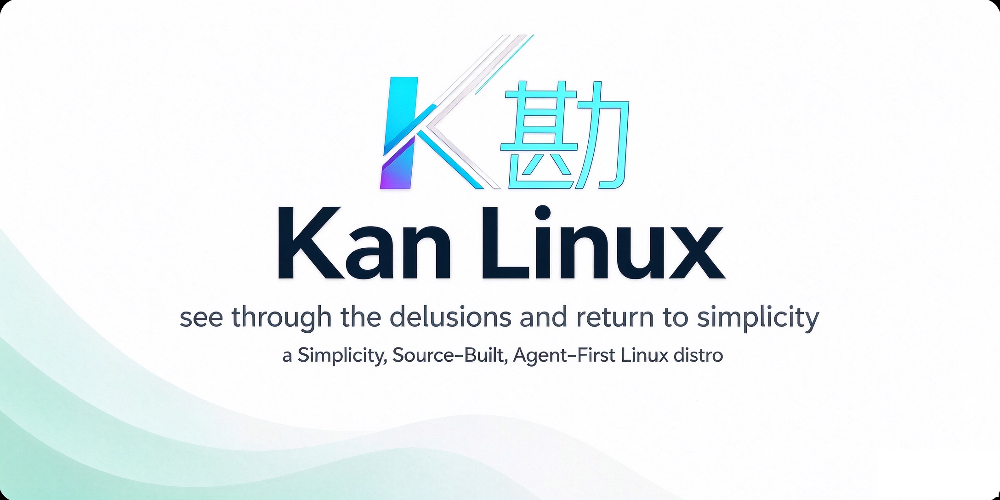

  <picture>
    <source
      media="(prefers-color-scheme: dark)"
      srcset="assets/kanlinux-banner.png"
    />
    <source
      media="(prefers-color-scheme: light)"
      srcset="assets/kanlinux-banner.png"
    />
    
  </picture>

<!--<h1 align="center">Kan-Linux</h1>-->

  <strong>English</strong> |
  <a href="/docs/README.zh-CN.md">中文</a>

 

## Description

**Kan-Linux**(or KanLinux) is a **Concise**, **Security** and **Agent‑First** Linux distribution\. The name **Kan(勘)** derives from *Instructions for Practical Living* by [Wang Yangming](https://en.wikipedia.org/wiki/Wang_Yangming), representing the philosophy of breaking through technical obscurations and returning to the system’s original simplicity\. The name **Kan(勘)** also stands for "*see through the delusions and return to simplicity*".

The main goal of Kan-Linux is to build a concise, secure and Agent-first Linux distro at the edge --- locally and in the cloud.

#### Design Principles
- Simplicity --- Eliminate overly complex wrapper layers and overengineering, following the core philosophy of [ggml/llama.cpp](https://github.com/ggml-org/llama.cpp). **Kan-Linux is not dependent on any existing Linux distribution.**
  - Keep the LiveISO compact while supporting a rich set of modern desktop features.
  - The full self-hosting bootstrapping pipeline covers only the OS base system. Heavy desktop applications(chromium,[office suite](https://www.libreoffice.org/download-other/)...) are built separately on top of a fully bootstrapped Kan-Linux instance and distributed as optional artifacts (similar to the pinned official Firefox tar.gz/tar.xz releases).
  - **No GNOME or KDE desktop stacks.** While GTK and Qt are capable toolkits, Kan-Linux builds a lean, minimal desktop environment from scratch. Applications are pluggable, with no mandatory global metadata, introspection subsystems, or complex hidden runtime contracts.

- Monorepo --- Drawing lessons from many existing Linux distributions and the highly complicated [Yocto Project](https://www.yoctoproject.org/), Kan-Linux adopts an AOSP-style single-repository architecture. All source code resides in one repository to simplify development, builds, and maintenance.

- Secure --- Our goal is not an unbreakable system, but to shrink the TCB and attack surface, while maximizing SBOM clarity and supply-chain security.
  - Optimized for single-user desktop workflows to reduce attack surface.
  - Source-built --- The base OS and its components are compiled from source, with a small explicit exception list: prebuilt artifacts such as Go, Rust, Firefox, Vulkan SDK, and user-installed software. This maximizes SBOM transparency and supply-chain auditability.
  - **SELinux is excluded intentionally to keep the TCB minimal.**
  - AI-native security audit pipeline --- Kan-Linux embeds LLM-powered source-level security auditing (GLM-5.3 and other high-capability models) as a mandatory pre-compilation gate, complementing human review. Security validation shifts from post-hoc binary scanning to source-code admission review.
  - 100% full self-hosting; 100% reproducible builds.

- Agent-First
  - **Only Flatpak is provided(since v0.3.4), no other traditional package manager.** [AI agents are a core component of Kan-Linux](https://github.com/kan-linux/kan-agent): they autonomously compile, deploy, install components, run system health checks, and resolve issues.
  - llama.cpp-First --- A native, integrated llama.cpp edge inference engine is provided for local AI deployment.
  - Maintain a balance between Agent-first automation and plain human-readable interfaces and workflows.

#### Differences and Connections with Omarchy
- Omarchy-Linux targets end users, delivering an out-of-the-box complete desktop system, with **visual polish as one of its core goals**. **Kan‑Linux is built for programmers and AI researchers**, providing a neutral, modern pure Wayland-based Linux distribution. Focused on **controllability**, **auditability**(no black-box within the OS), **modularity and reproducible builds**, and **visual polish is not a project objective**.
- Kan‑Linux draws inspiration from [Omarchy’s desktop shell](https://github.com/kan-linux/omarchy), and integrates it as our optional early default desktop shell. We port this tasteful shell as an upper-layer UI example to show the capabilities of the Kan-Linux platform. Even if we remove or disable the Omarchy desktop shell in the future due to unexpected reasons, the whole system and graphics infrastructure can still run fully and independently.
- Omarchy-Linux is based on the upstream Arch Linux distribution, while Kan-Linux is built completely from scratch and **does not rely on any upstream Linux distribution**.
- Kan-Linux provides Omarchy-comparable desktop UI and keybindings plus powerful development environments for programmers and AI Agents.

#### Screenshots and LiveISO

Please refer to https://github.com/kan-linux/kan/releases/latest

## How to contribute

  Drawing inspiration from the policy models of Red Hat's RHEL and the <a href="https://en.wikipedia.org/wiki/XZ_Utils_backdoor" target="_blank" rel="noopener">XZ Utils backdoor</a>,
  <b>The real Kan-Linux's core system will not be fully open-sourced at the moment</b>:
  - Kan-Linux is another HarmonyOS (also known as Hongmeng OS) and the fully HarmonyOS is not open-sourced at the moment(fully open-source HarmonyOS vs OpenHarmony), <b>this repo is Open-KanLinux, not KanLinuxOS</b>.
  - we will make Kan-Linux as secure as possible.
  That said, community contributions to other fully open components (such as Kan-Agent, desktop-shell) or upstream components (such as
          <a href="https://github.com/hyprwm/Hyprland" target="_blank" rel="noopener">Hyprland</a>,
          <a href="https://github.com/quickshell-mirror/quickshell" target="_blank" rel="noopener">Quickshell</a>,
          <a href="https://github.com/lgse/strata" target="_blank" rel="noopener">Strata</a>)
  of Kan-Linux are still welcome, pls refer to [our contributions to Linux community](https://kan-linux.org/about.html#oss).

## Fully open-source projects in Project Kan-Linux

1. Kan-Agent(based on pi,  we maintain our own downstream fork):  https://github.com/kan-linux/kan-agent
2. Hyprland(we maintain our own downstream fork):     https://github.com/kan-linux/Hyprland
3. strata:          https://github.com/kan-linux/strata
4. quickshell:   https://github.com/kan-linux/quickshell
5. omarchy desktop shell(featured/current desktop shell, we maintain our own downstream fork):     https://github.com/kan-linux/omarchy
6. screenshot(we maintain our own downstream fork): https://github.com/kan-linux/screenshot
7. ggml-hexagon(based on llama.cpp, we maintain our own downstream fork): https://github.com/kan-linux/ggml-hexagon
8. kernel: https://github.com/kan-linux/kernel
9. noctalia(candidate desktop shell, already verified on Kan-Linux v0.3.3):https://github.com/kan-linux/noctalia
10. fcitx(we maintain our own downstream fork): https://github.com/kan-linux/fcitx5

All of these fully open-source projects can be built and tested since Kan-Linux v0.3.3(screenshot can be built and tested since Kan-Linux v0.3.4, which will be released on Nov 28, 2026) . **Feel free to join the corresponding projects according to your expertise.**  Details can be found at [how to contribute](https://kan-linux.org/contribute.html). 

## Quick Start

[Quick Start](https://github.com/kan-linux/kan/discussions/43)

## Limitations
- Currently focus on x86-64 laptops, PCs and hardware
- [Kan-Agent](https://github.com/kan-linux/kan-agent) is under development
- Tested and verified on limited x86-64 laptops and PCs
- Built-in support for AMD and Intel GPUs. Nvidia GPU support requires assistance from the built-in Agent or a domain specialist
- The installer supports only single-OS installation to a specified partition or a standalone disk among multiple disks(this is a design choice, pls refer to ["why we do not offer dual‑boot or multi‑boot installation modes in Kan‑Linux"](https://github.com/kan-linux/kan/discussions/27)); LUKS encryption is not yet supported
- Potential undisclosed vulnerabilities in the Linux kernel and featured components

## Acknowledgements
- Inspired by Omarchy(**"Convention over Configuration"**) and [Omarchy's desktop shell](https://github.com/omacom/omarchy)
- Inspired by [llama.cpp](https://github.com/ggml-org/llama.cpp)
- Thanks to the entire Linux community(various tech orgs, such as Redhat(RHEL/Fedora/QEMU), SPI(Debian), Linux Foundation, Linaro, Canonical(Ubuntu), System76(Pop!_OS), UnionTech(Deepin/UOS)... and tech stacks)
- Thanks to the entire local AI community

## Trademarks
This project may include trademarks or logos belonging to third parties. Use of any third-party trademarks is governed by their respective policies.

