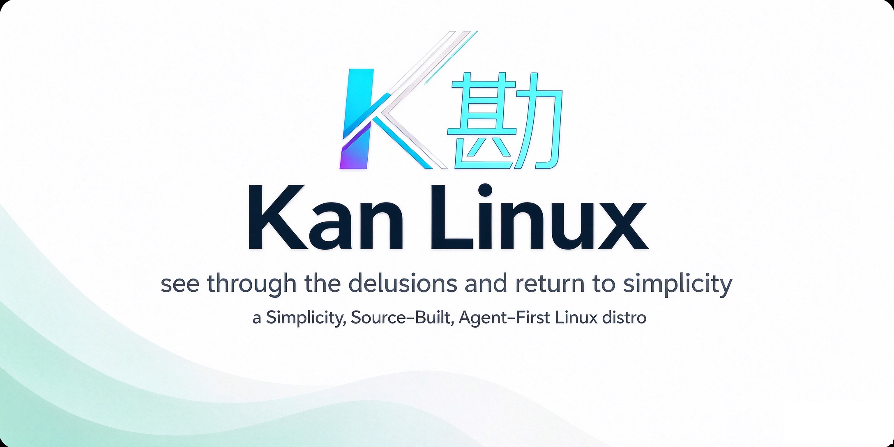

  <picture>
    <source
      media="(prefers-color-scheme: dark)"
      srcset="/assets/kanlinux-banner.png"
    />
    <source
      media="(prefers-color-scheme: light)"
      srcset="/assets/kanlinux-banner.png"
    />
    
  </picture>

<!--<h1 align="center">Kan-Linux</h1>-->

  <a href="/README.md">English</a> |
  <strong>简体中文</strong> 

**Kan（勘）Linux** 是一款基于过往操作系统开发经验，借鉴了llama.cpp与omarchy核心理念，重新打造的简洁、安全、AI-Agent优先的Linux发行版。

名称取自[王阳明](https://zh.wikipedia.org/zh-cn/%E7%8E%8B%E9%99%BD%E6%98%8E)《传习录》：**“此处能勘得破，方是简易透彻功夫”**。

项目以「勘破遮蔽、回归本真」为核心设计理念，构建精简、安全、Agent优先的全新Linux桌面发行版：面向本地PC/笔记本与云端虚拟机。

## 核心设计理念

- **简洁性** — 参考[ggml/llama.cpp](https://github.com/ggml-org/llama.cpp)项目的核心理念，拒绝过度封装与过度设计，不依赖已有任何Linux发行版，LiveISO控制在2GiB以下，便于下载试用/安装.

- **Monorepo** — 汲取现有各类 Linux 发行版的经验教训尤其是高度复杂/过度设计的[Yocto](https://www.yoctoproject.org/)项目的经验教训，采用AOSP风格的单仓库架构。所有全部源码存放/托管于单一代码仓库，简化开发、构建与维护工作。同时汲取了各种Linux发行版的教训与AOSP的经验，采取“声明式配置”与不可变架构“的代码/组件管理方式，大幅度降低维护负担，同时缩小漏洞攻击面。

- **源码构建** — 整套系统及所有组件（Go,Rust,Firefox为官方发布的二进制）均支持从源代码编译构建

- **安全**  — 默认不会上传任何数据，没有遥测，您可以用内置的wireshark进行核验,或者用各种工具在您的白盒环境中进行验证

- **llama.cpp 优先** — 内置原生 llama.cpp 端侧推理引擎，原生支持本地 AI 部署与端侧智能计算

- **Agent First** — Kan-Linux不依赖任何已有Linux发行版，除了内置的Flatpak，没有各种发行版自带的传统包管理器，对于非程序员用户，Agent是必须的而非仅仅只是口号。面向智能代理设计，支持AI Agent自主编译组件、安装组件、系统自查与问题修复

- **原生 AI 安全审计流水线** — Kan-Linux 将大模型源码级安全审计（GLM-5.3 及同等级模型）设为编译前的强制准入关卡。将安全防护从「二进制后置扫描」升级为**源码前置准入审计**。

## 如何贡献

#### Open-KanLinux与KanLinux OS的区别

[本仓库](https://github.com/kan-linux/kan)当前并非完全开源，类似华为鸿蒙OS与开源鸿蒙的区别.

#### 如何参与Project Kan-Linux

本项目有如下10个完全开源子项目，您可以根据自己的技术兴趣与技术专长参与.

1. Kan-Agent(based on pi,  we maintain our own downstream fork):  https://github.com/kan-linux/kan-agent
2. Hyprland(we maintain our own downstream fork):     https://github.com/kan-linux/Hyprland
3. strata:          https://github.com/kan-linux/strata
4. quickshell:   https://github.com/kan-linux/quickshell
5. omarchy desktop shell(featured/current desktop shell, we maintain our own downstream fork):     https://github.com/kan-linux/omarchy
6. screenshot(we maintain our own downstream fork): https://github.com/kan-linux/screenshot
7. ggml-hexagon(based on llama.cpp, we maintain our own downstream fork): https://github.com/kan-linux/ggml-hexagon
8. kernel: https://github.com/kan-linux/kernel
9. noctalia(candidate desktop shell, already verified on Kan-Linux v0.3.3):https://github.com/kan-linux/noctalia
10. fcitx(we maintain our own downstream fork): https://github.com/kan-linux/fcitx5

## 快速开始

#### 截图与LiveISO

详见: https://github.com/kan-linux/kan/releases/latest

#### Kan-Linux日常使用指南 

[入口](https://github.com/kan-linux/kan/discussions/43)

#### 已知问题
- 当前只运行在基于x86-64芯片的台式机与笔记本电脑
- [Kan-Agent](https://github.com/kan-linux/kan-agent) 正在开发中
- 在有限的台式机与笔记本电脑上做过测试
- 内置支持AMD与Intel显卡， 一些Nvidia显卡的支持可能需要得到专业技术人员辅助或使用内置Agent辅助
- 安装程序不支持双系统安装(这是一个设计决策,请参考["why we do not offer dual‑boot or multi‑boot installation modes in Kan‑Linux"](https://github.com/kan-linux/kan/discussions/27)); 安装程序不支持LUKS加密
- 还未公开的内核安全漏洞或与操作系统组件有关的安全漏洞

## 致谢
- 感谢 [Omarchy Linux](https://github.com/omacom/omarchy) 带来的启发
- 感谢 [llama.cpp](https://github.com/ggml-org/llama.cpp) 带来的启发
- 感谢全体 Linux 社区（各个专业技术组织与各种复杂的技术栈）
- 感谢全体 Local AI社区(各个专业技术组织与各种复杂的技术栈)

## 许可证
本项目采用 MIT 许可证。

## 商标声明
本项目可能包含第三方商标或标识，第三方商标的使用需遵守其各自的相关规定。

