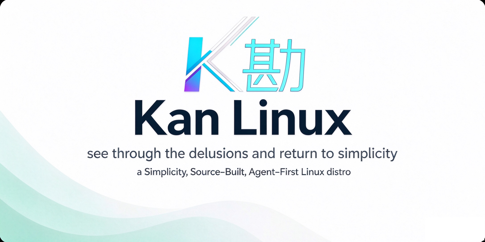

  <picture>
    <source
      media="(prefers-color-scheme: dark)"
      srcset="/assets/kanlinux-banner.png"
    />
    <source
      media="(prefers-color-scheme: light)"
      srcset="/assets/kanlinux-banner.png"
    />
    
  </picture>

<!--<h1 align="center">Kan-Linux</h1>-->

  <a href="/README.md">English</a> |
  <strong>简体中文</strong> 

**Kan（勘）Linux** 是一款基于过往Linux发行版开发经验，借鉴了llama.cpp与omarchy核心理念，重新打造的简洁、安全、AI-Agent优先的Linux发行版。

名称取自[王阳明](https://zh.wikipedia.org/zh-cn/%E7%8E%8B%E9%99%BD%E6%98%8E)《传习录》：**“此处能勘得破，方是简易透彻功夫”**。

项目以「勘破遮蔽、回归本真」为核心设计理念，构建精简、安全、Agent优先的全新Linux桌面发行版：面向本地PC/笔记本与云端虚拟机。

## 核心设计理念

- **简洁性** — 参考[ggml/llama.cpp](https://github.com/ggml-org/llama.cpp)项目的核心理念，拒绝过度封装与过度设计，不依赖已有任何Linux发行版

- **Monorepo** — 汲取现有各类 Linux 发行版的经验教训尤其是高度复杂/过度设计的[Yocto](https://www.yoctoproject.org/)项目的经验教训，采用AOSP风格的单仓库架构。所有全部源码存放/托管于单一代码仓库，简化开发、构建与维护工作。同时汲取了各种Linux发行版的教训与AOSP的经验，采取“声明式配置”与不可变架构“的代码/组件管理方式，大幅度降低维护负担，同时缩小漏洞攻击面。

- **源码构建** — 整套系统及所有组件（Go,Rust,Firefox为官方发布的二进制）均支持从源代码编译构建

- **llama.cpp 优先** — 内置原生 llama.cpp 端侧推理引擎，原生支持本地 AI 部署与端侧智能计算

- **Agent First** — Kan-Linux不依赖任何已有Linux发行版，没有各种发行版自带的复杂包管理器，对于非程序员用户，Agent是必须的而非仅仅只是口号。面向智能代理设计，支持AI Agent自主编译组件、安装组件、系统自查与问题修复

- **原生 AI 安全审计流水线** — Kan-Linux 将大模型源码级安全审计（GLM-5.3 及同等级模型）设为编译前的强制准入关卡。将安全防护从「二进制后置扫描」升级为**源码前置准入审计**。

## 与 Omarchy 的区别与联系
- Omarchy 面向终端用户，主打开箱即用的成品桌面系统，**视觉炫酷是其核心目标之一**。
- Kan‑Linux 面向程序员与AI领域人士，项目核心目标为**可控**、**可审计(没有任何黑盒/后门，你清楚你所使用的Linux OS的每个组件)**、**模块化、可复现构建**，**不以视觉炫酷作为项目目标**。
- Kan‑Linux 借鉴了Omarchy的核心理念“约定大于配置”与 [Omarchy 的桌面 Shell](https://github.com/kan-linux/omarchy)，将其集成作为可选的早期默认桌面。我们移植该 Shell 作为上层 UI 示例，用以展示 Kan-Linux 平台能力。未来即使移除或禁用 Omarchy Shell，整套系统与图形基础设施仍可完整独立运行。
- Omarchy 基于上游 Arch Linux 发行版构建，而 Kan-Linux 完全从零搭建，**不依赖任何上游 Linux 发行版**。

## 截图与LiveISO
详见：https://github.com/kan-linux/kan/releases/tag/v0.3.1

## 致谢
- 感谢 [Omarchy Linux](https://github.com/omacom/omarchy) 带来的启发
- 感谢 [llama.cpp](https://github.com/ggml-org/llama.cpp) 带来的启发
- 感谢全体 Linux 社区（各个专业技术组织与各种复杂的技术栈）
- 感谢中国顶尖AI大模型的帮助

## 许可证
本项目采用 MIT 许可证。

## 商标声明
本项目可能包含第三方商标或标识，第三方商标的使用需遵守其各自的相关规定。

